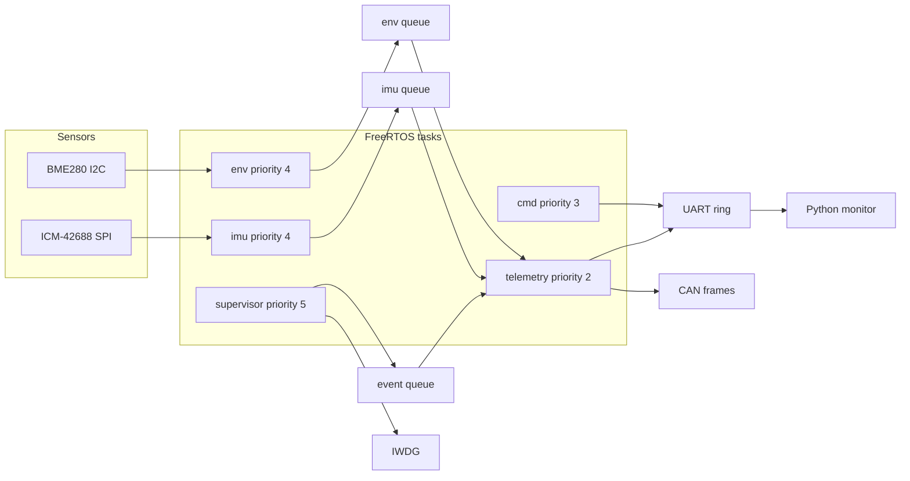

# TelemetryNode

FreeRTOS firmware that samples a BME280 (temperature, humidity, pressure) over I2C and an ICM-42688-P (accel, gyro) over SPI, then ships the samples on an interrupt-driven UART and as classic CAN frames. A Python monitor opens that UART, checks the CRC, prints the samples, and can force a task stall to watch the watchdog bring the node back.

The host build runs the same tasks on the FreeRTOS POSIX port. Sensor chips and the CAN controller are modeled in-process, and the UART is a pty (or a TCP byte stream) so the monitor is ordinary pySerial. STM32F407 and ESP32 board files are included for a real chip; they are type-checked here against thin stand-ins for the vendor headers.

## Features

- Separate acquisition and transmit tasks. The env task and the IMU task push samples into their own queues. The telemetry task is the only thing that packetises and writes the UART, so a slow link does not stall sampling.
- BME280 register driver with the datasheet's integer compensation, and an ICM-42688-P SPI driver (±4 g, ±500 dps).
- UART TX and RX go through a lock-free ring. On the host a thread plays the role of the UART interrupt. On STM32 the USART2 IRQ fills the same ring. On ESP32 the IDF UART driver posts events from its ISR.
- Classic CAN 2.0 frames (11-bit id, DLC ≤ 8). Environmental data is one frame; the IMU is split across an accel frame and a gyro frame. The host keeps a small software bus with an acceptance filter. STM32 sends the same frames in bxCAN loopback. ESP32 sends them on TWAI in no-ack mode.
- CRC-16/CCITT-FALSE on every UART frame.
- A supervisor task restarts a task that stops kicking. If the supervisor itself stalls, the IWDG resets the process (host) or the chip (STM32 IWDG / ESP32 task watchdog).
- The monitor decodes frames, logs CRC and link errors, and checks that samples resume after a watchdog recovery.

## Architecture



Task periods are configuration, not a measured result: environment samples every 200 ms, IMU samples every 20 ms, the supervisor runs every 20 ms. A supervised task is stale after 400 ms without a kick. The IWDG window is 1.5 s.

## Frame format

Little-endian. CRC-16/CCITT-FALSE (poly 0x1021, init 0xFFFF) covers the version byte through the payload.

| offset | field |
| --- | --- |
| 0 | `0xAA` |
| 1 | `0x55` |
| 2 | version `1` |
| 3 | type |
| 4 | sequence, uint16 |
| 6 | payload length |
| 7 | payload |
| 7+len | crc16 |

| type | name | payload |
| --- | --- | --- |
| `0x01` | env | int32 temp (0.01 °C), uint32 Pa, uint16 humidity (0.01 %), uint32 ms |
| `0x02` | imu | 7 × int16: ax, ay, az mg, gx, gy, gz in 0.1 dps, temp 0.01 °C; then uint32 ms |
| `0x03` | can | uint16 id, uint8 dlc, 8 data bytes |
| `0x10` | wdg | task id, cause, uint16 recovery count, uint32 stale ms |
| `0x11` | log | severity, code, ASCII text |

CAN ids: `0x180` environment, `0x280` accel, `0x281` gyro, `0x300` health (boot count, recoveries, uptime).

The monitor can write ASCII lines back. The command task reads those bytes out of the RX ring:

| line | effect |
| --- | --- |
| `PING` | log frame `PONG` |
| `STATS` | log drop, overflow, and recovery counts |
| `STALL env 800` | that task stops kicking for 800 ms |
| `STALL supervisor` | supervisor stops kicking the IWDG |
| `GLITCH` | flip one payload byte on the next frame so the CRC fails |

Task ids in the watchdog frame are `env`, `imu`, `telem`, `supervisor`.

## Layout

```
firmware/include/          shared headers
firmware/src/              protocol, drivers, FreeRTOS tasks
firmware/platform/host/    POSIX port, sensor models, pty/TCP UART, IWDG thread
firmware/platform/stm32/   STM32F407 HAL board file and its FreeRTOSConfig.h
firmware/platform/esp32/   ESP-IDF board file
third_party/FreeRTOS-Kernel/  kernel V11.2.0 plus the GCC POSIX port
python/telemetry_monitor/  decoder and pySerial monitor
tests/                     C and C++ unit tests
```

The `shim/` directories under the STM32 and ESP32 ports exist so those board files compile on the host. A real build removes that include path and uses STM32Cube or ESP-IDF.

## Run it locally

```bash
cmake -S . -B build
cmake --build build -j
./build/telemetry_node
```

That prints `UART_LINK=/tmp/telemetry-node-uart` (a symlink to the pty slave) and starts sampling. In another shell, from the repo root:

```bash
PYTHONPATH=python python3 -m telemetry_monitor --port /tmp/telemetry-node-uart
```

`--check` stalls the env task and exits 0 only if a watchdog frame arrives and env samples continue. `--log telemetry.log` appends the same lines to a file.

Copy `.env.example` to `.env` to change the link, baud, or node id. Flags override the file: `--link`, `--baud`, `--node`. A TCP endpoint works the same way for a container or a machine without a pty:

```bash
./build/telemetry_node --link tcp://0.0.0.0:8765
PYTHONPATH=python python3 -m telemetry_monitor --port socket://127.0.0.1:8765
```

Python dependencies are `pyserial` and `pytest` (`python/requirements.txt`).

```bash
docker compose up --build
```

The node listens on port 8765. The monitor container connects, runs the recovery check, and exits.

## Tests

```bash
cmake -S . -B build && cmake --build build -j
ctest --test-dir build --output-on-failure
```

`make test` does the same thing. Unit tests cover CRC, framing, BME280 compensation against the datasheet's floating-point formulas, the ICM scale factors, the host sensor models, CAN packetising and the acceptance filter, the UART rings, and the stale-task mask. The pytest suite talks to a live node: it checks sample ranges, CAN ids, a forced CRC error, task recovery, a supervisor stall that trips the IWDG, and the TCP endpoint.

## Board ports

**STM32F407.** HSE 8 MHz, PLL to 168 MHz. I2C1 on PB8/PB9 at 400 kHz. SPI1 on PA5/PA6/PA7, chip-select PA4, mode 0. USART2 on PA2/PA3, RXNE and TXE handled in `USART2_IRQHandler` rather than the HAL UART state machine, so the byte path is the shared ring. CAN1 on PD0/PD1 is left in loopback at 500 kbit/s. The IWDG uses the LSI with prescaler 64. Use `firmware/platform/stm32/FreeRTOSConfig.h` and the upstream GCC/ARM_CM4F port; the host config and the POSIX port are only for the Linux build. `vApplicationTickHook` calls `HAL_IncTick` so `HAL_GetTick` stays in step with the RTOS tick.

**ESP32 (ESP-IDF 5).** I2C master on GPIO 21/22. SPI2 on GPIO 23/19/18, CS GPIO 5, 8 MHz. UART1 on GPIO 17/16; a task blocks on the driver event queue, which the driver's ISR fills. TWAI on GPIO 25/26, 500 kbit/s, no-ack, so frames go out with no second node. The supervisor's first kick subscribes that task to the task watchdog. `app_main` does not start the scheduler; IDF already has.

## Design notes

Acquisition and transmission are different priorities on purpose. Sampling sits above the telemetry task, and the supervisor sits above both, so a full TX ring cannot starve a kick. Queues are not overwritten in place: a full queue increments a drop counter and the sample is discarded. `STATS` reports that count.

The UART ring is single-producer single-consumer with atomic head and tail. The ISR (or the host thread that stands in for it) never calls a FreeRTOS API. That keeps the POSIX port, which is not safe to enter from a foreign pthread, out of the interrupt path. The command task polls the ring instead of blocking in a driver call.

Restarting a stalled task is a `vTaskDelete` plus a new `xTaskCreate`, and the stall flag is cleared so the new task actually runs. The supervisor does not try to restart itself. That case is the hardware watchdog: on the host the IWDG thread `exec`s the process, the boot count increments, and the reason string becomes `iwdg`.

CAN frames are built in a small C++ packetiser and then handed to `can_sim`, which is the filter and the counter. The platform hook is optional. The UART still carries a copy of each accepted frame so a serial log is enough to see the bus.

The BME280 model does not invent engineering units behind the driver's back. It writes a calibration block and raw ADC codes; the driver reads them and compensates. The host model searches for the ADC code that compensates back to the scripted environment, which is why a unit test can compare the integer result with the datasheet's double-precision formulas.
